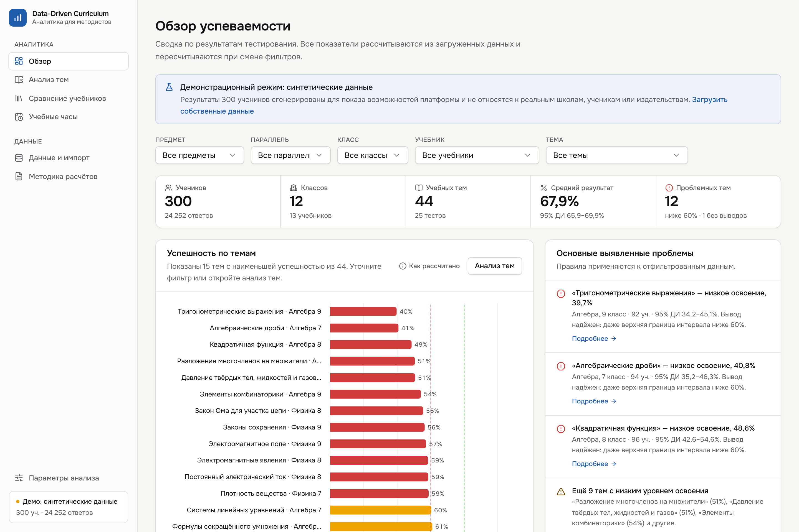
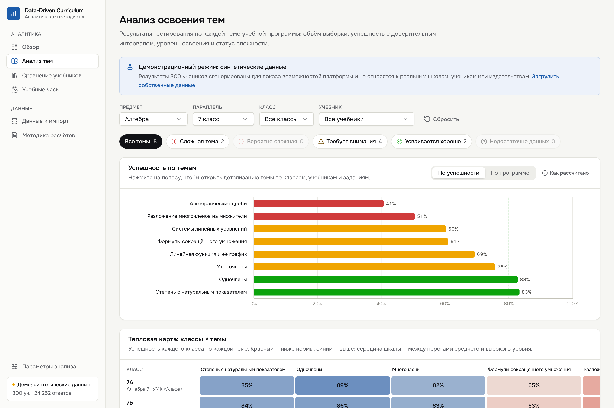
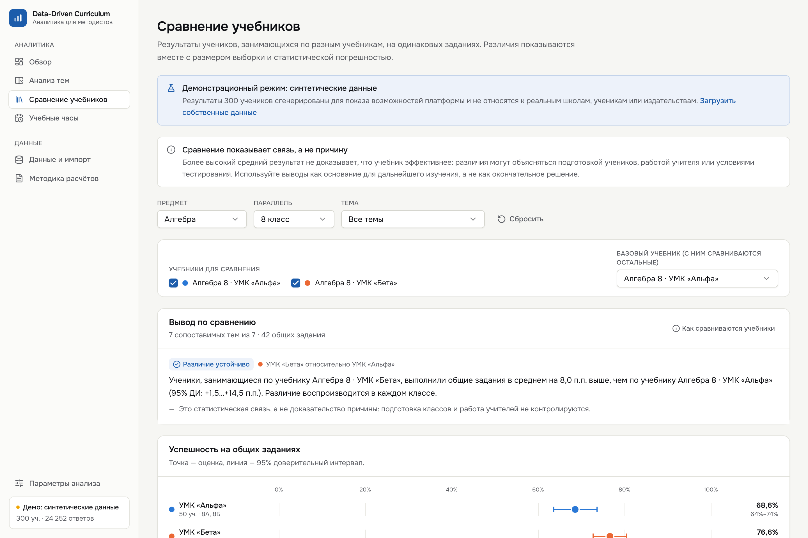
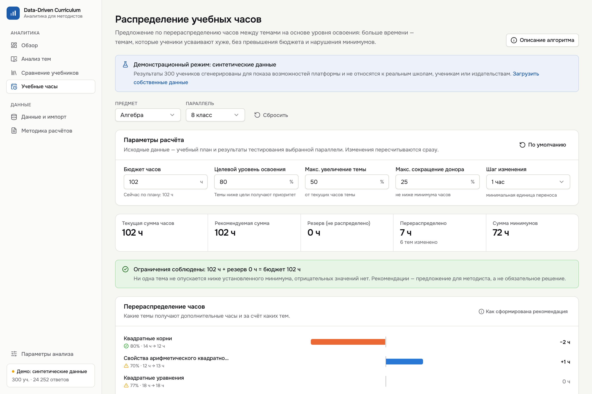
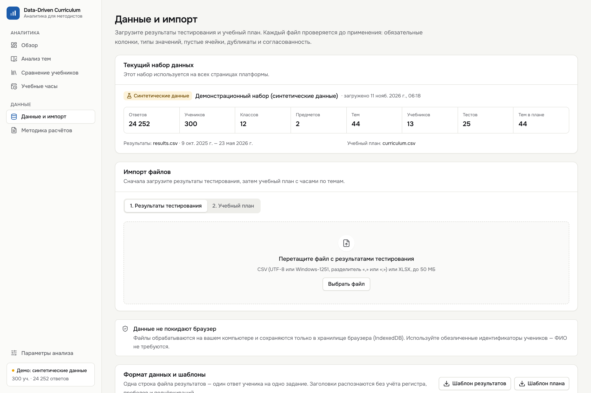

# Data-Driven Curriculum

**Интеллектуальная система оценки эффективности учебников и учебных программ** — EdTech-платформа для методистов. Кейс хакатона Zhambyl Hub.

Платформа переводит решения о выборе учебников и планировании часов из субъективной плоскости в измеримую: все выводы рассчитываются воспроизводимыми формулами из результатов тестирования.



## Что умеет платформа

| Задача кейса | Где в интерфейсе | Как решается |
|---|---|---|
| 1. Анализ результатов тестирования по темам | **Анализ тем** | Успешность каждой темы с 95% доверительным интервалом, объёмом выборки, уровнем освоения; тепловая карта «класс × тема»; сортируемая таблица; детализация темы по классам, учебникам и отдельным заданиям |
| 2. Выявление сложных разделов | **Обзор**, **Анализ тем** | Статусы «Сложная тема» / «Вероятно сложная» с учётом надёжности вывода; автоматический список проблем (сложные темы, отстающие классы); темы с малой выборкой явно помечаются |
| 3. Сравнение эффективности учебников | **Сравнение учебников** | Только сопоставимые группы (один предмет и параллель), только общие задания; разница с 95% интервалом; проверка устойчивости по классам; явная оговорка «связь ≠ причина» |
| 4. Рекомендации по распределению часов | **Учебные часы** | Детерминированная эвристика: приоритет тем с низким освоением, соблюдение бюджета и минимумов, конфликт при невыполнимых ограничениях, причина изменения для каждой темы, экспорт в CSV |

Дополнительно: импорт CSV/XLSX с проверкой и предпросмотром (**Данные и импорт**), описание всех формул (**Методика расчётов**), настраиваемые пороги (**Параметры анализа**).

| Анализ тем | Сравнение учебников |
|---|---|
|  |  |
| **Учебные часы** | **Импорт данных** |
|  |  |

## Быстрый старт

Требуется Node.js 20.9 или новее.

```bash
npm install
npm run dev
```

Откройте http://localhost:3000. При первом запуске загружается демонстрационный набор (синтетические данные 300 учеников). Собственные данные загружаются на странице «Данные и импорт».

Продакшен-сборка:

```bash
npm run build
npm start
```

### Скрипты

| Команда | Назначение |
|---|---|
| `npm run dev` | Режим разработки |
| `npm run build` / `npm start` | Продакшен-сборка и запуск |
| `npm test` | Модульные тесты расчётов и импорта (Vitest) |
| `npm run test:e2e` | Сквозная проверка в браузере (нужен запущенный сервер; при необходимости `npx playwright install chromium`) |
| `npm run lint` / `npm run typecheck` | ESLint и проверка типов TypeScript |
| `npm run generate:demo` | Пересоздать демонстрационный набор в `public/demo/` |

## Формат входных данных

Поддерживаются CSV (UTF-8 или Windows-1251, разделитель `,` `;` или табуляция) и XLSX (первый лист). Заголовки распознаются без учёта регистра, пробелов и подчёркиваний; поддерживаются русские синонимы («Класс», «Тема», «Верно» и т. д.). Шаблоны скачиваются на странице «Данные и импорт».

### Результаты тестирования — одна строка на один ответ

| Колонка | Обязательна | Описание | Пример |
|---|---|---|---|
| `student_id` | да | Обезличенный идентификатор ученика | `S0001` |
| `class_id` | да | Класс-группа | `7А` |
| `grade` | нет | Параллель; если нет — берётся из начала `class_id` | `7` |
| `subject` | да | Предмет | `Алгебра` |
| `topic_id` | да | Код темы | `ALG7-05` |
| `topic_name` | да | Название темы | `Разложение многочленов на множители` |
| `textbook_id` | да | Код учебника | `ALG7-ALPHA` |
| `textbook_name` | да | Название учебника | `Алгебра 7 · УМК «Альфа»` |
| `test_id` | да | Код теста | `ALG7-T3` |
| `question_id` | да | Код задания внутри теста | `Q05` |
| `is_correct` | да | `1/0`, `true/false`, `да/нет` | `1` |
| `test_date` | да | `ГГГГ-ММ-ДД` или `ДД.ММ.ГГГГ` | `2026-02-12` |

### Учебный план — одна строка на тему

| Колонка | Обязательна | Описание |
|---|---|---|
| `subject` | да | Предмет (как в результатах) |
| `grade` | да | Параллель (`7` или `7 класс`) |
| `topic_id` | да | Код темы (как в результатах) |
| `topic_name` | нет | Название темы |
| `current_hours` | да | Текущие часы, кратно 0,5 |
| `min_hours` | да | Минимально допустимые часы |

### Проверка при импорте

- обязательные колонки, типы значений (ответ, дата, параллель, часы), пустые ячейки;
- точные дубликаты ответа удаляются с предупреждением, противоречивые (один ученик/задание с разными результатами) — исключаются как ошибки;
- согласованность: класс относится к одной параллели, задание — к одной теме, одна тема — одно название;
- сверка плана с результатами (темы без результатов, темы вне плана, курсы без плана);
- предпросмотр первых строк и строк с ошибками, номера проблемных строк.

Некорректные строки не попадают в расчёты незаметно: методист исправляет файл или явно подтверждает импорт только корректных записей. Данные обрабатываются и хранятся только в браузере (IndexedDB).

## Аналитические методы

Подробное описание с формулами — на странице **«Методика расчётов»** в приложении. Кратко:

**Успешность** = верные ответы / все ответы. Пустая выборка даёт «—», а не 0 и не NaN.

**95% доверительный интервал** — кластерная оценка доли по ученикам (ответы одного ученика связаны): `Var(p) ≈ Σ(cⱼ − p·nⱼ)² / (k(k−1)·n̄²)`; интервал не уже интервала Уилсона.

**Уровни освоения** (настройка MVP, не стандарт; меняется в «Параметрах анализа»): высокий — от 80%, средний — 60–79%, низкий — ниже 60%. Пороги и минимальные объёмы выборки централизованы в `src/lib/config/analysis-config.ts`.

**Сложность темы**: «Сложная» — ниже порога и верхняя граница интервала тоже ниже; «Вероятно сложная» — интервал пересекает порог. Вывод делается только при ≥10 учениках и ≥30 ответах.

**Сравнение учебников**: один предмет и параллель → только общие задания (≥3 на тему) → темы без данных/с малой выборкой исключаются → итог по общим заданиям с 95% интервалом разницы. Уровни вывода: «Недостаточно данных», «Различие не подтверждено», «Предварительный вывод» (учебник в одном классе, классы пересекаются или разброс между классами сопоставим с разницей), «Различие устойчиво» (значимо, ≥2 класса на учебник, все классы одного учебника лучше всех классов другого). Любой вывод сопровождается оговоркой, что это связь, а не причина.

**Распределение часов** (эвристика, расчёт в целых получасах — бюджет сходится точно):

1. если сумма минимумов больше бюджета — конфликт, план не строится;
2. база — текущие часы, поднятые до минимума; при превышении бюджета часы снимаются с наиболее освоенных тем;
3. приоритет = (цель − успешность) / цель; потребность = часы × макс. увеличение (50%) × приоритет;
4. источник — свободный бюджет, затем темы с освоением не ниже цели (каждая отдаёт ≤25% и не ниже минимума);
5. остаток бюджета показывается как резерв; темы без надёжных данных не меняются.

## Архитектура

```
src/
  app/                    маршруты App Router (тонкие page.tsx)
  components/
    ui/                   компоненты в стиле shadcn/ui (Radix + Tailwind)
    charts/               графики: Recharts + лёгкие HTML/SVG (тепловая карта, forest plot)
    common/               фильтры, бейджи уровней, параметры анализа, состояния загрузки
    views/                страницы: обзор, темы, учебники, часы, данные, методика
    layout/               оболочка приложения и навигация
  lib/
    domain/types.ts       доменная модель (ответ, учебный план, фильтры)
    config/               пороги и параметры анализа
    analytics/            чистые функции расчётов (без React): stats, topics, heatmap,
                          overview, insights, textbooks, hours, filters
    data/                 разбор CSV/XLSX, схема колонок, проверка, хранение, экспорт
  providers/              единый набор данных, фильтры и настройки для всех страниц
tests/                    модульные тесты (Vitest)
e2e/                      сквозная проверка в браузере (Playwright)
scripts/                  генератор синтетического набора
public/demo/              демонстрационные CSV
```

Ключевые решения:

- **Расчёты отделены от интерфейса.** Вся аналитика — чистые функции в `src/lib/analytics`, покрытые тестами; компоненты только отображают результат.
- **Один набор данных.** Демо-данные проходят тот же конвейер разбора и проверки, что и загружаемые файлы; все страницы читают один набор и общие фильтры.
- **Без базы данных и внешних AI API.** Для MVP методисту достаточно браузерного хранилища; данные учеников не покидают компьютер. Слой `lib/data/storage.ts` изолирован, поэтому перенос в Supabase PostgreSQL не затронет аналитику и интерфейс.

## Демонстрационные данные

`public/demo/` — **синтетический** набор (генератор `scripts/generate-demo-data.ts`, фиксированный seed): 300 учеников, параллели 7–9 по 4 класса, предметы «Алгебра» и «Физика», 44 темы, 2–3 вымышленных УМК на курс, 25 тестов, 24 252 ответа. Имена учебников и школ вымышлены и не относятся к реальным издательствам.

В набор заложены сценарии для демонстрации:

- сложные темы в каждой параллели (например, «Алгебраические дроби», «Тригонометрические выражения»);
- «Алгебра 7»: УМК «Гамма» используется только в слабом классе 7Г — платформа показывает значимую разницу, но помечает вывод как предварительный;
- «Алгебра 7», «Алгебраические дроби»: 7Г писал другой вариант теста — сравнение идёт по 3 общим заданиям из 9;
- «Алгебра 8»: УМК «Бета» даёт устойчивое преимущество в обоих классах;
- «Алгебра 9»: реальной разницы между учебниками нет — «различие не подтверждено»;
- «Физика 8», «Электромагнитные явления»: полностью разные варианты — тема несопоставима;
- «Физика 9», «Ядерная физика»: тест писали 8 учеников — «недостаточно данных».

## Проверка качества

`npm test` — 58 модульных тестов, в том числе:

- расчёт процента успешности, интервалов, границ порогов;
- выявление проблемных тем и отказ от вывода при малой выборке;
- сравнение учебников только по общим заданиям, исключение несопоставимых тем, уровни вывода;
- пустые и неполные выборки, отсутствие NaN/Infinity во всех расчётах демо-набора;
- сохранение бюджета и минимальных часов, в том числе на 400 случайных планах;
- импорт CSV: кодировки, разделители, русские заголовки, ошибки, дубликаты, конфликты;
- корректная работа после импорта нового CSV.

`npm run test:e2e` — 20 проверок в браузере: все страницы без NaN, изменение порогов, сравнение учебников, детализация темы, импорт CSV с ошибками и XLSX, учебный план, конфликт бюджета, возврат демо-данных, отсутствие ошибок в консоли.

## Ограничения MVP

- Ответы оцениваются как верно/неверно, без частичных баллов и взвешивания по трудности заданий.
- Сравнение учебников не учитывает исходный уровень классов (входная диагностика в формат пока не входит).
- Пороги и параметры перераспределения часов — настройки MVP, их нужно согласовать с методическим объединением.
- Нет многопользовательского режима, авторизации и интеграций с LMS (вне рамок текущего этапа).
