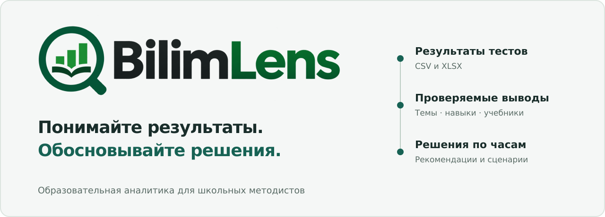
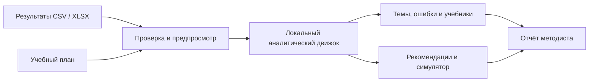

<p align="center">
  
</p>

<h1 align="center">BilimLens</h1>

<p align="center">
  <strong>От результатов тестирования — к обоснованным решениям об учебной программе.</strong><br />
  Темы, навыки, учебники и учебные часы — в едином аналитическом пространстве.
</p>

<p align="center">
  
  
  
  
</p>

<p align="center">
  <a href="#capabilities">Возможности</a> ·
  <a href="#start">Быстрый старт</a> ·
  <a href="#demo">Демонстрация</a> ·
  <a href="#data">Формат данных</a> ·
  <a href="#verification">Проверки</a> ·
  <a href="docs/RELEASE.md">Статус выпуска</a>
</p>

---

**BilimLens** помогает школьным методистам увидеть сложные темы, сопоставить результаты по учебникам и перераспределить учебное время. Вместо разрозненных таблиц — связанный путь от загруженного ответа до объяснения рекомендации.

Проект разработан для кейса **Data-Driven Curriculum** хакатона **Zhambyl Hub**. Его основа — воспроизводимая образовательная аналитика: каждая цифра рассчитывается из данных, а недостаток наблюдений остаётся видимым.

> **Рекомендация должна объясняться.** Если данных недостаточно, BilimLens сообщает об этом. Если навыки или категории ошибок не указаны, платформа не придумывает их.

<a id="capabilities"></a>
## Решения, которые поддерживает BilimLens

| Освоение материала | Выбор учебников | Планирование времени |
| :--- | :--- | :--- |
| Найти темы и задания, которые вызывают трудности. | Сравнить сопоставимые группы по общим заданиям. | Перераспределить часы с учётом бюджета и минимумов. |
| Увидеть объём выборки и доверительный интервал. | Отделить устойчивое различие от предварительного вывода. | Проверить свой сценарий и сохранить результат. |

### Девять разделов — один набор данных

| Раздел | Что получает методист | Маршрут |
| :--- | :--- | :--- |
| **Обзор** | Общая успешность, проблемные темы, распределение уровней и переход к деталям. | `/` |
| **Анализ тем** | 95% доверительные интервалы, тепловая карта «класс × тема», детализация по заданиям и группам. | `/topics` |
| **Сравнение учебников** | Сопоставление внутри предмета и параллели; общие задания, разница результатов и ограничения вывода. | `/textbooks` |
| **Учебные часы** | Рекомендуемый план, соблюдение бюджета, минимумы и причина изменения каждой темы. | `/hours` |
| **Анализ ошибок** | Статистика заданий и классов; слабые навыки и категории ошибок при наличии метаданных. | `/skills` |
| **Симулятор** | Текущий, рекомендованный и пользовательский планы; редактирование по 0,5 часа, резерв, сброс и CSV. | `/simulator` |
| **Отчёты методиста** | Показатели, проблемные темы, учебники, ошибки, рекомендации и ограничения в одном отчёте. | `/reports` |
| **Данные и импорт** | Загрузка CSV/XLSX, предпросмотр, проверка ошибок, дубликатов и согласованности. | `/data` |
| **Методика расчётов** | Формулы, пороги, допущения и объяснение алгоритмов. | `/methodology` |

**Экспорт:** рекомендации и сценарии — в CSV; основной отчёт — отдельный **PDF из пяти страниц A4 landscape** с выделяемым текстом, векторными диаграммами и встроенными шрифтами. Полные таблицы скачиваются отдельным PDF-приложением. Недопустимый сценарий нельзя экспортировать.

**Языки интерфейса:** русский · қазақша · English · 中文 · español · français · Deutsch · Türkçe · oʻzbekcha. Названия предметов, тем и другие значения из загруженных файлов сохраняются в исходном виде.

## Новый рабочий сценарий

На компьютере левую панель можно полностью скрыть и вернуть кнопкой в верхней части рабочей области. Содержимое занимает освободившуюся ширину; выбор сохраняется в браузере. На телефоне остаётся выдвижное меню.

Навигация построена вокруг трёх вопросов: **что произошло → почему → что делать**. Главный вывод показан первым, графики раскрывают основания, а большие таблицы и методологические подробности открываются по запросу. Для тем, навыков, классов, заданий и редактируемых часов предусмотрены страницы; все принятые исходные ответы доступны в разделе импорта и выгружаются в CSV.

Отчёт оформлен самостоятельно, независимо от размеров окна: **краткие итоги → пробелы в освоении → учебники → учебные часы → план действий**. PDF не содержит скриншота веб-страницы.

## Как устроен путь от данных к решению



Данные обрабатываются в браузере и сохраняются в **IndexedDB**. Для работы не нужны внешняя база данных, регистрация или ключи AI API. Результаты учеников не отправляются на сервер приложения.

<a id="start"></a>
## Запуск на своём компьютере

Нужны **Node.js 20.9+**, npm и Git.

```bash
git clone https://github.com/Dadrout/EDUTECH.git
cd EDUTECH
# Ветка с интеграцией BilimLens и этим README:
git switch ux/report-rebuild
npm ci
npm run dev
```

Откройте **http://localhost:3000**. При первом запуске приложение загрузит синтетический демонстрационный набор. Собственные файлы можно импортировать в разделе **«Данные и импорт»**.

<details>
<summary><strong>AI-объяснения (необязательно)</strong></summary>

AI-методист, AI-инсайты на страницах и AI-раздел PDF-отчёта работают через серверный маршрут `/api/ai`: Google Gemini — основной провайдер, Groq — резервный при временных ошибках. Без ключей вся аналитика работает, а AI-блоки сообщают, что AI не настроен.

```bash
cp .env.example .env.local   # укажите GEMINI_API_KEY и/или GROQ_API_KEY
```

- Ключи остаются на сервере; `.env.local` исключён из Git.
- Провайдеру уходят только обезличенные агрегаты движка (темы, навыки, учебники, часы, размеры выборок); идентификаторы учеников и группы меньше 10 учеников не передаются.
- По умолчанию AI доступен только для синтетических демо-данных; для данных школы нужно явно задать `AI_ALLOW_UPLOADED_DATA=true`.
- Ответ проверяется на сервере: структура (Zod), ссылки на доказательства и каждое число в тексте должны совпадать с показателями движка. При несовпадении — один повтор с исправлением, затем ошибка вместо непроверенного ответа.
- Ограничения: лимит запросов в минуту и попыток в сутки, таймаут, повтор с паузой только при 429/503, проверка Origin, кэш одинаковых запросов.

Smoke-проверка реального провайдера (один короткий запрос): `node --env-file=.env.local --import tsx scripts/ai-smoke.ts gemini insight ru`.

</details>

<details>
<summary><strong>Production-сборка и запуск</strong></summary>

```bash
npm run build
npm start
```

В среде, запрещающей IPC Turbopack или отдельный процесс TypeScript, доступен проверенный альтернативный путь. Он сохраняет проверку типов:

```bash
BILIMLENS_IN_PROCESS_TSC=1 npm run build:webpack
npm start
```

</details>

<a id="demo"></a>
## Сценарий демонстрации

Демо позволяет изучить возможности без подготовки собственных файлов.

| Ученики | Ответы | Темы | Параллели | Предметы |
| :---: | :---: | :---: | :---: | :---: |
| **300** | **24 252** | **44** | **7–9** | **Алгебра и физика** |

**Все демонстрационные данные синтетические.** Названия учебников вымышлены; показатели не описывают реальные школы, учеников или издательства. Генератор использует фиксированный seed.

1. Откройте **«Обзор»**: найдите проблемную тему и посмотрите надёжность вывода.
2. В **«Анализе тем»** откройте тему и изучите задания и различия между классами.
3. Выберите **«Алгебра», 8 класс** в **«Сравнении учебников»**: демо содержит сценарий устойчивого различия на общих заданиях.
4. В **«Анализе ошибок»** изучите навыки, распределение категорий и число наблюдений.
5. Откройте **«Учебные часы»**, затем **«Симулятор»**: измените распределение, проверьте остаток бюджета и сравните три плана.
6. Откройте **«Отчёты методиста»**: скачайте пятистраничный PDF, затем при необходимости отдельное приложение с детализацией.

В набор также заложены разные варианты тестов, учебник в единственном классе и темы с малой выборкой — чтобы показать, когда платформа **ограничивает вывод**, а не усиливает его.

## Аналитика, которую можно проверить

| Принцип | Как он реализован |
| :--- | :--- |
| **Наблюдения не равны ученикам** | Число ответов и число учеников считаются отдельно; повторные ответы одного ученика учитываются в кластерной оценке. |
| **Процент сопровождается неопределённостью** | Успешность тем показывается с 95% доверительным интервалом и объёмом выборки. |
| **Малая выборка не становится уверенным выводом** | Для темы по умолчанию нужны не менее 10 учеников и 30 ответов. |
| **Сравнение требует общей основы** | Учебники сопоставляются внутри одного предмета и параллели, по общим заданиям. Связь с результатом не доказывает причинность. |
| **Навыки берутся из метаданных** | `skill` и `error_type` необязательны. Без них остаётся анализ заданий; категории не восстанавливаются догадкой. |
| **Часы — управляемый ресурс** | Эвристика учитывает бюджет, минимумы и приоритеты. Симулятор не прогнозирует рост успеваемости. |
| **Отчёт использует тот же движок** | Показатели собираются из существующих аналитических функций, а не из отдельной модели «для отчёта». |

Пороги освоения — **настройки продукта, а не образовательный стандарт**. Методист может изменить их в параметрах анализа.

<details>
<summary><strong>Формулы и правила расчёта</strong></summary>

**Успешность** = верные ответы / все ответы. Пустая выборка даёт «—», а не 0 и не NaN.

**95% доверительный интервал** — кластерная оценка доли по ученикам (ответы одного ученика связаны): `Var(p) ≈ Σ(cⱼ − p·nⱼ)² / (k(k−1)·n̄²)`; интервал не уже интервала Уилсона.

**Уровни освоения** (настройка MVP, не стандарт; меняется в «Параметрах анализа»): высокий — от 80%, средний — 60–79%, низкий — ниже 60%. Пороги и минимальные объёмы выборки централизованы в `src/lib/config/analysis-config.ts`.

**Сложность темы**: «Сложная» — ниже порога и верхняя граница интервала тоже ниже; «Вероятно сложная» — интервал пересекает порог. Вывод делается только при ≥10 учениках и ≥30 ответах.

**Сравнение учебников**: один предмет и параллель → только общие задания (≥3 на тему) → темы без данных/с малой выборкой исключаются → итог по общим заданиям с 95% интервалом разницы. Уровни вывода: «Недостаточно данных», «Различие не подтверждено», «Предварительный вывод» (учебник в одном классе, классы пересекаются или разброс между классами сопоставим с разницей), «Различие устойчиво» (значимо, ≥2 класса на учебник, все классы одного учебника лучше всех классов другого). Любой вывод сопровождается оговоркой, что это связь, а не причина.

**Распределение часов** (эвристика, расчёт в целых получасах — бюджет сходится точно):

1. если сумма минимумов больше бюджета — конфликт, план не строится;
2. база — текущие часы, поднятые до минимума; при превышении бюджета часы снимаются с наиболее освоенных тем;
3. приоритет = (цель − успешность) / цель; потребность = часы × макс. увеличение (50%) × приоритет;
4. источник — свободный бюджет, затем темы с освоением не ниже цели (каждая отдаёт ≤25% и не ниже минимума);
5. остаток бюджета показывается как резерв; темы без надёжных данных не меняются.

Исходный код: [статистика](src/lib/analytics/stats.ts) · [темы](src/lib/analytics/topics.ts) · [учебники](src/lib/analytics/textbooks.ts) · [часы](src/lib/analytics/hours.ts) · [навыки и ошибки](src/lib/analytics/skills.ts) · [сценарии](src/lib/analytics/scenario.ts) · [отчёты](src/lib/report/report.ts).

</details>

<a id="data"></a>
## Ваши данные: CSV и XLSX

Поддерживаются **CSV в UTF-8 и Windows-1251** с разделителями `,`, `;` или табуляцией, а также **первый лист XLSX**. Заголовки распознаются без учёта регистра, пробелов и подчёркиваний; поддерживаются русские синонимы. Шаблоны скачиваются в интерфейсе.

<details>
<summary><strong>Колонки, примеры и правила импорта</strong></summary>

### Результаты тестирования — одна строка на один ответ

| Колонка | Обязательна | Описание | Пример |
|---|---|---|---|
| `student_id` | да | Обезличенный идентификатор ученика | `S0001` |
| `class_id` | да | Класс-группа | `7А` |
| `grade` | нет | Параллель; если нет — берётся из начала `class_id` | `7` |
| `subject` | да | Предмет | `Алгебра` |
| `topic_id` | да | Код темы | `ALG7-05` |
| `topic_name` | да | Название темы | `Разложение многочленов на множители` |
| `textbook_id` | да | Код учебника | `ALG7-ALPHA` |
| `textbook_name` | да | Название учебника | `Алгебра 7 · УМК «Альфа»` |
| `test_id` | да | Код теста | `ALG7-T3` |
| `question_id` | да | Код задания внутри теста | `Q05` |
| `is_correct` | да | `1/0`, `true/false`, `да/нет` | `1` |
| `test_date` | да | `ГГГГ-ММ-ДД` или `ДД.ММ.ГГГГ` | `2026-02-12` |
| `skill` | нет | Навык из метаданных задания; отсутствие не заменяется догадкой | `Работа со знаками` |
| `error_type` | нет | Категория неверного ответа; известные коды или собственный текст | `sign` |

### Учебный план — одна строка на тему

| Колонка | Обязательна | Описание |
|---|---|---|
| `subject` | да | Предмет (как в результатах) |
| `grade` | да | Параллель (`7` или `7 класс`) |
| `topic_id` | да | Код темы (как в результатах) |
| `topic_name` | нет | Название темы |
| `current_hours` | да | Текущие часы, кратно 0,5 |
| `min_hours` | да | Минимально допустимые часы |

### Проверка при импорте

- обязательные колонки, типы значений (ответ, дата, параллель, часы), пустые ячейки;
- точные дубликаты ответа удаляются с предупреждением, противоречивые (один ученик/задание с разными результатами) — исключаются как ошибки;
- согласованность: класс относится к одной параллели, задание — к одной теме, одна тема — одно название;
- сверка плана с результатами (темы без результатов, темы вне плана, курсы без плана);
- предпросмотр первых строк и строк с ошибками, номера проблемных строк.

Некорректные строки не попадают в расчёты незаметно: методист исправляет файл или явно подтверждает импорт только корректных записей. Данные обрабатываются и хранятся только в браузере (IndexedDB).

</details>

**Область отчёта:** предмет и параллель. Остальные фильтры не применяются, чтобы сохранить полную выборку курса. Рекомендации по часам в отчёте строятся с параметрами по умолчанию и бюджетом текущего плана; пользовательский сценарий экспортируется отдельно.

## Архитектура и стек

**Next.js 16.4 · React 19.3 · TypeScript · Tailwind CSS 4 · Radix UI · Recharts · Vitest · Playwright**

```text
src/
├── app/                 Маршруты Next.js App Router
├── components/
│   ├── layout/          Оболочка и навигация
│   ├── views/           Девять разделов приложения
│   ├── charts/          Графики, тепловая карта и интервалы
│   ├── common/          Фильтры, статусы и состояния данных
│   └── ui/              Базовые компоненты на Radix UI
├── lib/
│   ├── analytics/       Чистые функции образовательной аналитики
│   ├── report/          Сборка отчёта из результатов движка
│   ├── data/            Парсинг, валидация, хранение и экспорт
│   ├── domain/          Доменные типы
│   └── config/          Пороги и параметры анализа
├── i18n/                Одна типизированная система, девять языков
└── providers/           Общие данные, фильтры и настройки

tests/                   Модульные тесты и серверный рендеринг
e2e/                    Браузерные сценарии Playwright
public/demo/             Синтетические CSV
scripts/                 Воспроизводимый генератор демо
```

Расчёты отделены от React. Демо и пользовательские файлы проходят один конвейер проверки; все страницы работают с общим набором данных. Обновление локализации не создаёт вторую систему переводов.

<a id="verification"></a>
## Проверки и текущий статус

Результаты проверки интеграции от **11 ноября 2026 года**:

| Проверка | Результат |
| :--- | :--- |
| TypeScript | Пройдена |
| ESLint | Пройдена, без предупреждений |
| Модульные тесты и серверный рендеринг | **172 теста в 15 файлах — пройдены** |
| Production-сборка Webpack | Пройдена, все девять маршрутов приложения |
| Девять словарей локализации | Проверены ключи, параметры, множественное число и название продукта |
| Независимый code review | Найденные функциональные дефекты исправлены и покрыты регрессионными тестами |
| Браузерные E2E, responsive и визуальный QA | **Не завершены: среда блокирует запуск браузера и сервера (`EPERM`)** |
| PDF и пагинация | Проверены A4 landscape, выделяемый текст, встроенные шрифты, поля и отдельное приложение; выполнены два цикла просмотра PDF |
| Production-деплой | Не выполнялся в рамках проверки интеграции |

**Готовность к демонстрации ещё не подтверждена.** Успешная сборка не заменяет браузерную проверку. Описание UX-перестройки и проверки PDF — в [отчёте о перестройке](docs/UX-REBUILD.md); исходная проверка интеграции сохранена в [журнале выпуска](docs/RELEASE.md).

<details>
<summary><strong>Команды разработки и проверки</strong></summary>

| Команда | Назначение |
| :--- | :--- |
| `npm run dev` | Локальная разработка |
| `npm run build` | Production-сборка Turbopack |
| `npm run build:webpack` | Альтернативная production-сборка Webpack |
| `npm start` | Запуск собранного приложения |
| `npm run typecheck` | Проверка типов |
| `npm run lint` | ESLint |
| `npm test` | Тесты аналитики, импорта, словарей и рендеринга |
| `npm run test:e2e` | Браузерные сценарии; нужен запущенный сервер и Chromium |
| `npm run generate:demo` | Пересоздание синтетических CSV |
| `npm run pdf:preview` | Создать PDF на демо-наборе без браузера |
| `npm run pdf:preview -- --kk` | Создать казахский образец; `--zh` — китайский, `--all` — все курсы |
| `npm run test:pdf` | Проверка PDF и извлечения текста |
| `npm run verify:pdf` | Проверка готовых PDF через Poppler: страницы, текст, поля |

Для E2E запустите production-сервер в отдельном терминале. Если Chromium не установлен:

```bash
npx playwright install chromium
npm run test:e2e
```

Адрес сервера можно задать через `BASE_URL`. Дополнительный набор сохраняет скриншоты и PDF в `/tmp/bilimlens-browser-qa`; после просмотра и исправлений повторите запуск с `QA_PASS=2`. Повторный запуск сам по себе не означает прохождение визуального QA.

</details>

## Границы продукта

- Ответы оцениваются как верно/неверно, без частичных баллов и весов сложности заданий.
- Сравнение учебников не учитывает входной уровень классов; описательные различия между классами могут зависеть от набора заданий.
- Распределение часов — объяснимая эвристика для решения методиста, без обещания роста успеваемости.
- PDF генерируется локально библиотекой pdf-lib и скачивается напрямую. Основной документ содержит пять обзорных страниц; полные таблицы вынесены в отдельное приложение. Редкие символы вне покрытия встроенных шрифтов вызывают явную ошибку с указанием символа.
- Многопользовательский режим, авторизация и интеграции с LMS не входят в текущий объём.

## Документация проекта

| Документ | Содержание |
| :--- | :--- |
| [PRODUCT.md](PRODUCT.md) | Аудитория, назначение продукта и обязательства бренда |
| [DESIGN.md](DESIGN.md) | Токены, типографика и правила интерфейса |
| [docs/UX-REBUILD.md](docs/UX-REBUILD.md) | Аудит девяти страниц, новая информационная архитектура и проверка PDF |
| [docs/RELEASE.md](docs/RELEASE.md) | Восстановление проекта, результаты проверок и открытые условия выпуска |
| [Демонстрационные данные](public/demo/) | CSV для воспроизводимого знакомства с аналитикой |
| [Оригинальный логотип](docs/assets/bilimlens-logo.png) | Предоставленный логотип BilimLens, сохранённый без изменений |

Архивные скриншоты в `docs/screenshots/` показывают предыдущую версию MVP и **не являются изображениями текущего интерфейса**. Обложка README — графическое оформление проекта, а не скриншот приложения.

---

<p align="center">
  <strong>BilimLens — видеть пробелы, понимать причины ограничений, планировать осознанно.</strong><br />
  Проект для кейса Data-Driven Curriculum · Zhambyl Hub
</p>
